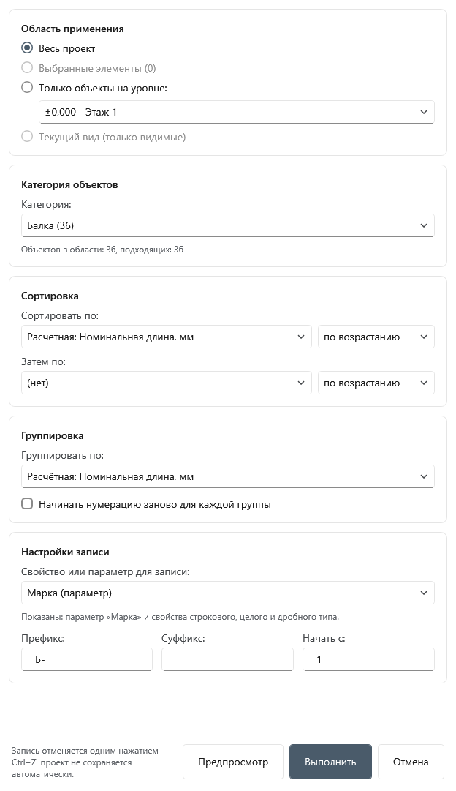
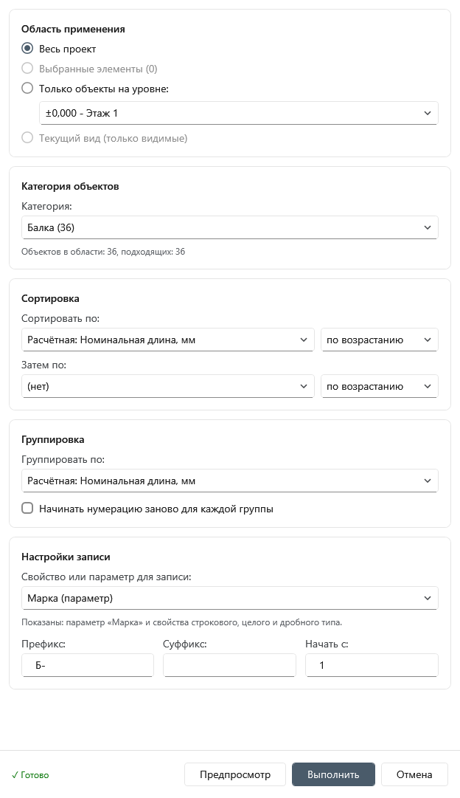
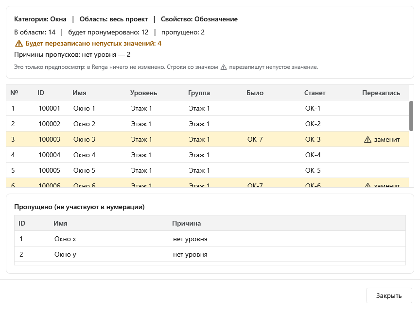

# Автонумерация для Renga

Плагин для [Renga](https://rengabim.com): нумерует объекты одной выбранной категории (стены, балки, помещения, двери и любые другие) в выбранной области и записывает номера в свойство проекта или в параметр («Марка», «Номер помещения»). Порядок номеров задаётся сортировкой, в том числе по расчётным характеристикам (например, по номинальной длине балок), и группировкой.

Версия 0.1.

> Картинки в этом README - отрисовка окон плагина в тестовом приложении (с условными данными), а не снимки экрана из Renga: в самой Renga у окон есть заголовок и рамка, а категории и свойства будут вашими.

## Возможности
- **Область применения**: весь проект, выбранные в модели объекты, только объекты на выбранном уровне или только видимые на текущем виде.
- **Любая категория**: за один запуск нумеруется один тип объектов, при открытии окна ничего не выбрано. В списке - все типы, которые есть в выбранной области (кроме служебных «Соединений»).
- **Сортировка** в два уровня («Сортировать по» и «Затем по») с направлением. Ключом может быть ID, имя, уровень, свойство, параметр или **расчётная характеристика** («Номинальная длина», «Объём нетто», «Площадь» и другие, какие есть у выбранной категории). Объекты без значения ключа идут в конец, при равных ключах - по ID.
- **Группировка** по уровню, свойству, параметру или расчётной характеристике: объекты одной группы получают один номер, либо, с галочкой «Начинать нумерацию заново для каждой группы», счёт идёт заново в каждой группе. Расчётные характеристики для группировки округляются (длины и отметки - до 1 мм, площади - до 0,001 м², объёмы - до 0,0001 м³, масса - до 0,001 кг).
- **Куда писать**: параметр «Марка» (у категорий, где она есть), параметр «Номер помещения» (у помещений) или любое свойство проекта строкового, целого или дробного типа, назначенное выбранной категории. Для строк доступны префикс и суффикс, для чисел - просто число. Начальное число задаётся.
- **Предпросмотр** (по желанию): таблица «ID - имя - уровень - было - станет», объекты, у которых значение будет заменено, и список пропущенных с причинами.
- **Отмена**: вся запись выполняется одной операцией, один Ctrl+Z возвращает прежние значения. Проект плагин не сохраняет.
- **Строка состояния**: «Процесс запущен…», по окончании - «✓ Готово».
- Значения, которые уже совпадают с записываемыми, не пишутся повторно (при повторном запуске это быстрее).

## Требования
- Windows.
- Renga с поддержкой плагинов .NET 8 (в манифесте указан API 2.49).

## Установка
1. Скачайте архив `AutoNumbering-0.1.zip` на странице [Releases](../../releases).
2. Закройте Renga.
3. Распакуйте архив и скопируйте папку `AutoNumbering` в `C:\Program Files\Renga Professional\Plugins\` (потребуются права администратора).
4. Запустите Renga: на ленте появится кнопка «Автонумерация».

Если кнопки нет, посмотрите журнал `%localappdata%\Renga Software\Renga\AecApp.log`. Журнал самого плагина - `%localappdata%\Renga Software\Renga\AutoNumbering.log` (в нём время основных этапов и сообщения об ошибках).

## Как пользоваться
1. (Необязательно) выделите нужные объекты в модели или откройте нужный вид или уровень.
2. Нажмите «Автонумерация» на ленте.
3. Выберите область применения и категорию объектов.
4. Задайте сортировку и, если нужно, группировку.
5. В «Свойство или параметр для записи» выберите цель, при необходимости укажите префикс, суффикс и число, с которого начать.
6. (Необязательно) нажмите «Предпросмотр» и посмотрите, что и куда будет записано.
7. Нажмите «Выполнить». Окно не закрывается: пока идёт запись, внизу написано «Процесс запущен…», затем «✓ Готово». Результат можно отменить одним Ctrl+Z.

## Известные ограничения
- **Запись в параметр медленнее, чем в свойство.** Renga тратит около 30 мс на каждый объект (например, 4878 стен - около 2,7 минуты), запись в свойство - около 2 мс. Во время записи Renga не отвечает. Это ограничение самой Renga, ускорить его через API не удалось.
- **Сборки (экземпляры сборок) пронумеровать нельзя**: параметр «Марка» у них только для чтения, а свойств у них нет. В списке они есть, но вместо цели записи плагин показывает пояснение.
- Свойства с формулой в списке серые и недоступны для выбора. Свойства других типов (длина, площадь, перечисление, флажок и т. п.) в качестве цели записи не поддерживаются.
- Перезапись непустых значений идёт сразу, без отдельного подтверждения: проверьте результат в «Предпросмотре» (он показывает, что будет заменено) или отмените Ctrl+Z.
- Номера не проверяются на уникальность: объекты вне выбранной области не учитываются.
- Порядок «по ID» обычно совпадает с порядком создания объектов, но Renga этого не гарантирует.
- Список расчётных характеристик и наличие параметра «Марка» определяются по первым 20 объектам категории.
- Первое открытие окна на очень больших проектах может занимать десятки секунд (читается вся модель).
- Запись в «Марку» проверена на типах: стена, балка, колонна, перекрытие, крыша, лестница, дверь, окно, проём, отверстие, пластина, ограждение, сантехнический прибор, фундамент, «Элемент»; «Номер помещения» - на помещениях. Инженерные категории (трубы, воздуховоды, электрика) и арматура на запись не проверялись.

## О разработке
Плагин разработан с помощью искусственного интеллекта (Claude, Anthropic) под руководством автора. Работа плагина проверялась автором в Renga на тестовых проектах, но программа поставляется «как есть», без гарантий: перед использованием на важных проектах проверьте результат (запись отменяется Ctrl+Z).

## Лицензия
Все права защищены, см. [LICENSE](LICENSE). Исходный код не публикуется. Сторонние компоненты: сборки Renga SDK.
